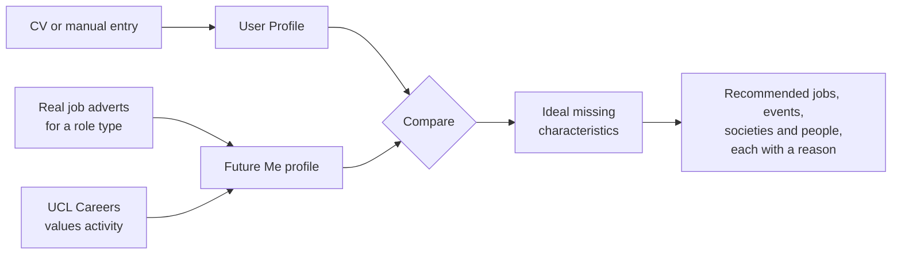
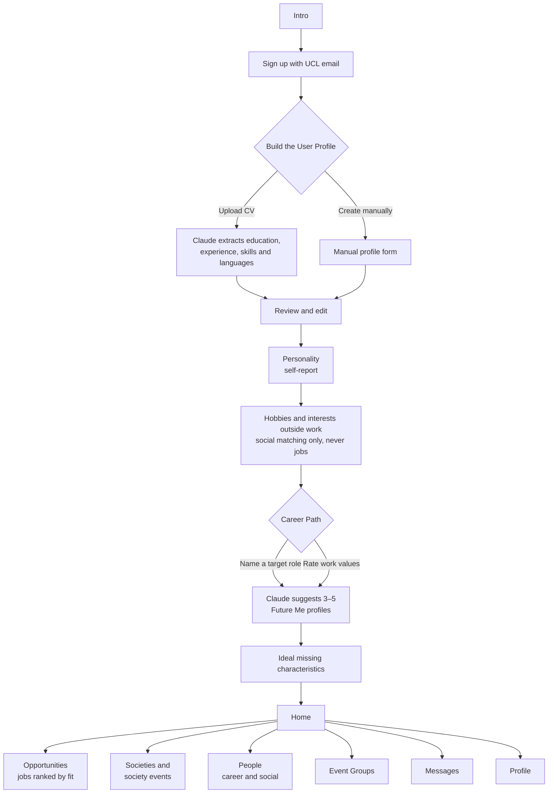

# LARP

<!-- TODO: what LARP stands for -->

**Become who you want to be at UCL.**

LARP is a web platform for UCL students. It matches each student with a **Future Me** profile: the profile of the role they want to reach. LARP compares the two and recommends the jobs, events, societies and people that help the student gain what is still missing. Every recommendation explains why. Students can also meet fellow students and alumni with similar interests or life paths, in small groups rather than one-to-one.

---

## Contents

1. [The Problem](#the-problem)
2. [The Core Idea](#the-core-idea)
3. [Context](#context)
4. [What Is Built and What Is Planned](#what-is-built-and-what-is-planned)
5. [User Journey](#user-journey)
6. [Modules](#modules)
7. [Data Sources](#data-sources)
8. [How Claude Powers LARP](#how-claude-powers-larp)
9. [Privacy and Safety](#privacy-and-safety)
10. [Technical Setup](#technical-setup)
11. [Business Model](#business-model)
12. [Team](#team)
13. [Licence](#licence)

---

## The Problem

Students have to fight to become who they want to be.

- **Scattered.** Opportunities, events and people are spread across WhatsApp, society pages, UCL Careers, Instagram and job portals.
- **No context.** Listings say what exists, not why it matters for a student's goals.
- **Hard to approach.** Knowing whom to talk to, and how to start, is hard.

<!-- TODO: add source — any survey data or student feedback on these problems -->

---

## The Core Idea



1. **User Profile.** Built from a CV (Claude extracts education, experience, skills and languages) or entered manually. The student reviews and edits it. Personality and hobbies are self-reported, never inferred.
2. **Future Me profile.** Built from real job adverts for a role type. Claude extracts the skills and experience each advert asks for, and LARP aggregates them (for example "communication: 82% of adverts"). Each role is also tagged with the work values it offers, using the UCL Careers values activity.
3. **Ideal missing characteristics.** LARP compares the User Profile with the Future Me profile. The result covers both experience and skills **and** work values.
4. **Recommendations.** Jobs, events, societies and people are ranked by how well they help the student gain those characteristics. Each one says why it was suggested.
5. **Social side.** Separately, students can meet fellow students and alumni with similar interests or life paths.

---

## Context

### The Hackathon

LARP is being built for the **Claude Campus Hackathon + Showcase**, run by **UCL Entrepreneurs × Claude Builder Club UCL**.

| Detail | Information |
| --- | --- |
| Date | Friday 16 October 2026, 4pm to 7pm |
| Venue | Jeffery Hall, UCL IOE, 20 Bedford Way |
| Track | Better Student Life |
| Team size | Up to four UCL students |
| Format | Building starts before the event, with about 1.5 hours of building on the day before demos are judged |
| Submission deadline | 6:20pm UK time on the day, via the organisers' form |
| Submission contents | Demo video, slides, PDF or walkthrough and an optional GitHub link |

**Track fit.** The track asks for something built with Claude that makes student life easier, more enjoyable or more connected. LARP turns scattered listings into a ranked, explained path towards a student's goal, and introduces students to people in low-pressure groups.

### University College London

University College London (UCL) was founded in 1826 in Bloomsbury, London. It was the first university in England to admit students regardless of their religion and among the first to admit women on equal terms with men. Today it is a multidisciplinary research university spanning the arts, sciences, engineering, medicine and social sciences. <!-- TODO: verify -->

### UCL School of Management

The UCL School of Management is UCL's business school. It sits within the Faculty of Engineering Sciences and is based at One Canada Square in Canary Wharf. Its teaching and research focus on analytics, technology, innovation and entrepreneurship. <!-- TODO: verify -->

### MSc Business Analytics

The MSc Business Analytics programme at the UCL School of Management combines data science and technology with management, preparing students to use data to analyse problems and inform business decisions. <!-- TODO: verify programme description against the official course page -->

---

## What Is Built and What Is Planned

The code today is the social and events half of LARP. The Future Me half is **Planned**.

| Area | Status | What exists today |
| --- | --- | --- |
| Sign up and log in | Built | Email and password (hashed with bcrypt), login tokens. `REQUIRE_UCL_EMAIL=true` limits sign-up to `@ucl.ac.uk` addresses |
| User Profile from a questionnaire | Built | Campus, study, experience, interests, goals and vibe |
| User Profile from a CV | Planned | |
| Personality (self-report) | Planned | |
| Future Me profiles and Career Path | Planned | |
| Ideal missing characteristics | Planned | |
| Opportunities (jobs ranked by fit) | Planned | |
| Events | Built | SU events, a hand-curated list and venues, tagged by type, with a Career and Social split |
| Societies | Planned | |
| People | Partly built | Browse page with matches scored on interests, goals, course, experience, vibe and campus |
| Event Groups | Partly built | Groups of 3–6 matched students with a suggested event. The accept or decline step is Planned |
| LinkedIn links | Built | "LinkedIn Max" lists students who chose to share their own link. LARP never contacts LinkedIn |
| Messages | Planned | |
| Profile page | Partly built | Shows answers and lets the student edit campus, travel, alcohol preference, goal and LinkedIn link. The Instagram-style layout is Planned |

---

## User Journey



---

## Modules

| Module | Purpose | Status |
| --- | --- | --- |
| User Profile | CV extraction or manual entry, reviewed and edited by the student | Questionnaire built, CV Planned |
| Future Me | Role profiles aggregated from real job adverts and tagged with work values | Planned |
| Career Path | Name a target role or rate work values, then choose from 3–5 Future Me profiles | Planned |
| Opportunities | Jobs ranked by how well they build the ideal missing characteristics | Planned |
| Societies | Societies and society events, ranked the same way | Planned |
| People | Students and alumni to meet, split into career and social | Partly built |
| Event Groups | Small groups going to the same event | Partly built |
| Messages | Conversations with connections and groups | Planned |
| Profile | The student's own page and settings | Partly built |

### Event Groups

There is **no one-to-one matching for events**. LARP invites the student to join a small group of 3–6 people with matching profiles who are going to the same event. The student only accepts or declines a **group**, never an individual, so nobody can be personally rejected.

Today the back end forms groups automatically (target 5, maximum 6, minimum 3) and suggests the best event for each group. The accept or decline step is Planned.

### Profile

An Instagram-style page (Planned):

- avatar, bio and stats (events, connections, societies)
- Future Me routes with progress
- badges
- a grid of attended, booked and saved events
- settings behind a gear icon

---

## Data Sources

| Source | How LARP gets it | Status |
| --- | --- | --- |
| Job adverts | Official jobs APIs (Adzuna or Reed). No LinkedIn scraping, which breaches LinkedIn's terms | Planned |
| LinkedIn | Only an opt-in link students add to their own profile | Built |
| Students' Union and society events | A polite scraper of the SU's public listing pages. It checks robots.txt, waits between requests and names a contact in its User-Agent | Built (runs only on request, with `DEMO_MODE=false`) |
| Hand-curated events | A checked list of real public events (`backend/app/seed/events_curated.json`), currently from the SU, ISE and DesignMyNight | Built |
| UCL Careers events | These sit behind UCL login, so the demo uses a hand-curated set of public events | Planned <!-- TODO: add curated UCL Careers events --> |
| UCL SSO and an official careers feed | Partnership milestones that need UCL approval. LARP cannot build these alone | Planned |

LARP never asks for UCL passwords.

---

## How Claude Powers LARP

LARP calls Claude through the Anthropic API.

| Task | Input | Output | Status |
| --- | --- | --- | --- |
| CV extraction | CV text | User Profile: education, experience, skills and languages | Planned |
| Future Me aggregation | Job adverts for a role type | Skills and experience with how often adverts ask for them | Planned |
| Work values to roles | A student's work value ratings | Suggested roles | Planned |
| Explanations | User Profile, Future Me profile and a recommendation | Ideal missing characteristics and why each recommendation helps | Planned |
| Event search | A search plan by category | Candidate events found with Claude's web search | Built |
| Event tagging | Event title and description | Tags from LARP's fixed list (unknown tags are thrown away) | Built |

**Every Claude call has a cached demo-mode fallback.** With `DEMO_MODE=true` LARP makes no live Claude calls and uses saved results. Tagging answers are cached per event, so the same event is never sent twice, and if Claude fails the pipeline keeps the keyword result.

---

## Privacy and Safety

- Personality and hobbies are self-reported, never inferred.
- Hobbies are used for social matching only, never for jobs.
- Students review and edit their User Profile before it is used.
- No one-to-one rejection: students accept or decline groups, not people.
- LARP never sends LinkedIn requests and never scrapes LinkedIn.
- LARP never asks for UCL passwords.
- Passwords are stored as bcrypt hashes, never in plain text.
- UK GDPR applies. A lawful basis, privacy notice and data protection impact assessment are needed before launch. <!-- TODO: confirm requirements with UCL data protection guidance -->

---

## Technical Setup

### Stack

| Part | Technology | Folder |
| --- | --- | --- |
| Back end | Python, FastAPI, SQLModel on SQLite | `backend/` |
| Front end | React 19, React Router, Vite and Tailwind CSS v4 | `frontend/` |
| AI | Anthropic API (Claude) | `backend/app/pipeline/` |
| Tests | pytest | `backend/tests/` |
| Hosting | Render (free tier) | |

### Repository Structure

```text
LARP-Project/
├── backend/
│   ├── app/            # API routes, matching, groups, events
│   │   ├── pipeline/   # event search, scraping and Claude tagging
│   │   └── seed/       # tags, practice students, curated events and venues
│   └── tests/
├── frontend/
│   └── src/            # pages, components and the API client
├── docs/               # brief, back-end spec, roadmap and setup notes
├── .env.example        # every setting, with no secrets
└── README.md
```

### Run it locally

You need Python 3.11, Node 24 and git.

```bash
git clone https://github.com/tomas-trls/LARP-Project.git
cd LARP-Project

# Settings: copy the example, then fill it in
cp .env.example .env                # Windows: copy .env.example .env

# Back end
cd backend
python3.11 -m venv .venv            # Windows: py -3.11 -m venv .venv
source .venv/bin/activate           # Windows: .venv\Scripts\activate
pip install -r requirements.txt
python -m app.reset_db              # loads tags, practice students, events and venues
uvicorn app.main:app --reload       # http://localhost:8000 (API docs at /docs)

# Front end, in a second terminal
cd frontend
npm install
npm run dev                         # http://localhost:5173
```

Run the tests from `backend/` with `python -m pytest`.

### Environment variables

All settings live in `.env`. `.env.example` lists every key with a comment. The main ones:

| Key | What it does |
| --- | --- |
| `ANTHROPIC_API_KEY` | Lets LARP call Claude. Get one at console.anthropic.com |
| `DEMO_MODE` | `true` means no live scraping and no live Claude calls |
| `JWT_SECRET` | Signs login tokens. Any long random string |
| `ADMIN_KEY` | Needed for the `/api/admin/*` routes |
| `FRONTEND_ORIGINS` | Front end addresses allowed to call the API (needed on Render) |
| `REQUIRE_UCL_EMAIL` | `true` allows only `@ucl.ac.uk` sign-ups |

> **Warning: never commit `.env` files.** They hold your API key and secrets. `.env` is git-ignored; only `.env.example` belongs in the repository.

### Hosting on Render

LARP runs on Render's free tier. <!-- TODO: add the live front end and API URLs -->

- The service **sleeps after 15 minutes idle**, so the first visit after a pause takes a while to wake it.
- **SQLite resets on restart**, so accounts made by hand do not survive. The interest tags load on startup. Loading the practice students and events on startup is Planned. <!-- TODO: load seed data on startup for Render -->
- Set `FRONTEND_ORIGINS` to the front end's Render address so the browser may call the API.

---

## Business Model

- **Free core network.**
- **Possible later revenue:** optional guided goal programmes, paid hosted experiences and employer or institutional partnerships, only after usage is proven.
- **Launch** as a focused pilot with UCL School of Management students before expanding.

See the business plan for detail. <!-- TODO: link to the business plan -->

---

## Team

We are four MSc Business Analytics students at the UCL School of Management.

| Name | Role | Contributions |
| --- | --- | --- |
| Tomas Truyols | Product Manager | <!-- TODO: contributions --> |
| <!-- TODO: name --> | Front-end lead | <!-- TODO: contributions --> |
| <!-- TODO: name --> | Back-end lead | <!-- TODO: contributions --> |
| <!-- TODO: name --> | Business lead | <!-- TODO: contributions --> |

---

## Licence

<!-- TODO: choose a licence (e.g. MIT) and add a LICENSE file -->
