# LARP database diagram (target design)

This is the planned shape of the database after the back-end re-plan (see `BACKEND_REPLAN.md`). GitHub draws the diagram below automatically. Tables marked **(existing)** are already in `backend/app/models.py`; the rest are added phase by phase. This file is updated in every push.

```mermaid
erDiagram
    USER ||--o{ EDUCATION : has
    USER ||--o{ EXPERIENCE : has
    USER ||--o{ USER_SKILL : has
    USER ||--o{ USER_LANGUAGE : speaks
    USER ||--o{ CV_UPLOAD : uploads
    USER ||--o{ PERSONALITY_ANSWER : answers
    USER ||--o{ USER_TAG : "hobbies"
    TAG  ||--o{ USER_TAG : ""

    SKILL ||--o{ USER_SKILL : ""
    SKILL ||--o{ SKILL_SYNONYM : "also written as"
    SKILL ||--o{ ROLE_SKILL : "required by"
    SKILL ||--o{ JOB_SKILL : "asked for in"
    ROLE  ||--o{ ROLE_SKILL : requires
    JOB   ||--o{ JOB_SKILL : asks
    ROLE  ||--o{ JOB : "advertised as"

    WORK_VALUE ||--o{ USER_WORK_VALUE : ""
    WORK_VALUE ||--o{ ROLE_WORK_VALUE : ""
    USER ||--o{ USER_WORK_VALUE : "top 3-5"
    ROLE ||--o{ ROLE_WORK_VALUE : offers

    USER ||--o{ USER_ROUTE : saves
    ROLE ||--o{ USER_ROUTE : "target of"
    USER_ROUTE ||--|{ ROUTE_SCORE : "5 category scores"

    USER ||--o{ JOB_SAVE : ""
    JOB  ||--o{ JOB_SAVE : ""

    USER ||--o{ CONNECTION : "sends / receives"
    USER ||--o{ FOLLOW : ""
    USER ||--o{ EVENT_PAIR : ""
    USER ||--o{ MATCH_CACHE : "ranked matches"

    EVENT ||--o{ EVENT_TAG : ""
    TAG   ||--o{ EVENT_TAG : ""
    EVENT ||--o{ EVENT_PAIR : ""
    EVENT ||--o{ EVENT_SAVE : ""
    USER  ||--o{ EVENT_SAVE : ""
    SOCIETY ||--o{ EVENT : hosts

    SOCIETY ||--o{ SOCIETY_MEMBER : ""
    USER    ||--o{ SOCIETY_MEMBER : joins
    SOCIETY ||--o{ SOCIETY_TAG : ""
    TAG     ||--o{ SOCIETY_TAG : ""
    SOCIETY ||--o{ SOCIETY_ROLE : offers
    SOCIETY_ROLE ||--o{ SOCIETY_ROLE_APPLICATION : ""
    USER ||--o{ SOCIETY_ROLE_APPLICATION : applies
    SOCIETY ||--o{ SOCIETY_ANNOUNCEMENT : posts

    GROUP ||--o{ GROUP_MEMBER : ""
    USER  ||--o{ GROUP_MEMBER : ""
    CONVERSATION ||--o{ CONVERSATION_MEMBER : ""
    USER ||--o{ CONVERSATION_MEMBER : ""
    CONVERSATION ||--o{ MESSAGE : ""
    USER ||--o{ MESSAGE : sends
    USER ||--o{ NOTIFICATION : receives
    USER ||--o{ NOTIFICATION_PREF : sets
    USER ||--o{ USER_BADGE : earns
    BADGE ||--o{ USER_BADGE : ""
```

`SKILL` is the hub: CV text, role requirements, job adverts and society roles all resolve to the same skill rows, which is what makes the fit scores comparable.

## Table guide

### Account and profile
| Table | Purpose |
|---|---|
| `user` (existing, changing) | One row per student or alumnus; profile, settings and personality result |
| `education`, `experience`, `user_language` | The reviewed CV or manual-entry profile |
| `cv_upload` | Extracted CV text and parse status (the file itself is not kept) |
| `personality_answer` | Answers to the agree/disagree statements |
| `email_verification` | One-time codes for UCL email sign-up |
| `tag`, `user_tag` (existing) | Hobbies and interests; social matching only, never jobs |

### Career engine
| Table | Purpose |
|---|---|
| `skill` | The single skill list, each in one of 5 categories: academics, skills, teamwork, experience, leadership |
| `skill_synonym` | Words that mean the same skill ("cooperative" → teamwork) |
| `user_skill` | Skills a student has, from CV or typed in |
| `role` | The searchable career-path list (name, sector, alumni count, median start salary) |
| `role_skill` | What a role requires, with an importance weight |
| `work_value`, `user_work_value`, `role_work_value` | UCL Careers values; the student's top 3–5; what each role offers |
| `user_route` | Roles a student saved as routes (one is active) |
| `route_score` | Five rows per route: the score in each category plus matched and missing skills |

### Opportunities (career events and jobs)
| Table | Purpose |
|---|---|
| `event`, `event_tag` (existing, extended) | All events; `category` is opportunity / social / society |
| `event_save` | Saved, going or attended |
| `job`, `job_skill`, `job_save` | Scraped job listings, the skills each asks for, and a student's saved/applied jobs |

### People
| Table | Purpose |
|---|---|
| `connection` | Request between two people (career or social); both must accept before messaging |
| `follow` | One-way follow for shared hobbies |
| `event_pair` | Two students going to an event together |
| `match_cache` (existing, extended) | Saved top matches with a reason and a conversation starter |
| `group`, `group_member` (existing, extended) | Small groups for an event |

### Societies
| Table | Purpose |
|---|---|
| `society`, `society_tag` | Directory with categories (including Academic) and interest tags |
| `society_member` | Who joined which society |
| `society_role`, `society_role_application` | Student rep roles and applications |
| `society_announcement` | Posts, some members-only |

### Messages and profile
| Table | Purpose |
|---|---|
| `conversation`, `conversation_member`, `message` | Direct, group, society and event chats |
| `notification`, `notification_pref` | Alerts and the student's switches |
| `badge`, `user_badge` | Society and social badges on the profile |

### Removed or parked
| Table | Status |
|---|---|
| `user_need` | Removed (not in the new screens) |
| `venue`, `venue_tag` | Parked: kept but unused |
| `classification_cache` (existing) | Kept; the same pattern caches Claude's skill answers |
